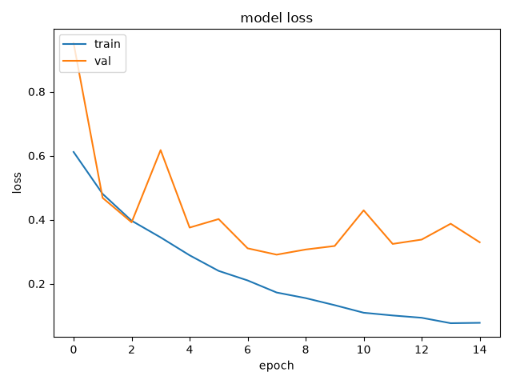

# Cat and Dog Image Classification Using CNN

An image-classification project that trains a convolutional neural network (CNN) to distinguish cats from dogs and includes a separate live webcam object detector.

**Project author: Mr Manish Kumar**

> **Important:** The project contains two different models. `main.py` trains the custom CNN saved as `18_000.h5`. The live webcam app uses the separately pretrained OpenCV Zoo YOLOX detector at `models/object_detection_yolox_2022nov.onnx`. The webcam can detect people, cats, and dogs; it does not load the custom CNN model.

## What this project does

- Trains a CNN using 18,000 labeled images from the Dogs vs. Cats training set.
- Splits those images into 14,400 training and 3,600 validation images.
- Saves the trained CNN, epoch history, accuracy/loss plots, and a prediction video for up to 200 images in `dataset/test1`.
- Runs a live webcam object detector that draws boxes and confidence scores around detected people, cats, and dogs.
- Displays **“No cat/dog detected”** when the detector does not find either animal.

## Results from the completed training run

| Metric | Result |
|---|---:|
| Training images used | 18,000 |
| Training / validation split | 80% / 20% |
| Epochs | 15 |
| Final training accuracy | 97.21% |
| Final validation accuracy | 89.31% |
| Final validation loss | 0.3293 |

Validation accuracy is measured on the held-out validation split. The `test1` images do not have labels in this project, so predictions on those images are not an accuracy measurement. A displayed confidence such as 90% is a model score, not a guarantee of 90% correctness.

### Training accuracy


### Training loss



### Live camera example

The webcam detector can find multiple cats in the same frame and draw a bounding box and confidence score for each detection.


## Repository layout

```text
image-classification-using-cnn/
├── dataset/                         # Local data only; not included in Git
│   ├── train/                       # Labeled cat/dog images (needed to retrain)
│   └── test1/                       # Unlabeled prediction images (optional)
├── models/
│   ├── object_detection_yolox_2022nov.onnx  # Used by live_camera.py
│   └── YOLOX_LICENSE.txt
├── main.py                          # Trains CNN and creates plots/video
├── live_camera.py                   # Runs the webcam object detector
├── model.py                         # CNN architecture
├── data_prep.py                     # Dataset loading and preprocessing
├── constants.py                     # Dataset paths and training settings
├── output/
│   ├── 18_000.h5                    # Completed custom CNN checkpoint
│   ├── 18_000_history.pickle        # Completed training metrics
│   ├── 18_000_15epoch_accuracy.png  # Accuracy graph
│   ├── 18_000_15epoch_loss.png      # Loss graph
│   └── prediction.mp4               # Example prediction video
└── requirements.txt
```

The dataset is not committed because it is large. The YOLOX detector is included, so the webcam demo can be run without downloading the training dataset. A completed CNN checkpoint and example training outputs are included in `output/`; running `main.py` creates fresh outputs in the project root.

## Quick start: run the live camera

### 1. Install Python

Install **Python 3.12 (64-bit)**. On Windows, the Python launcher command `py -3.12` is used below.

### 2. Download or clone this repository

```powershell
git clone https://github.com/manish7417/cat-dog-image-classification.git
cd image-classification-using-cnn
```

Alternatively, on the GitHub repository page choose **Code → Download ZIP**, extract the ZIP, and open the extracted project folder in VS Code.

### 3. Create an environment and install dependencies

Run these commands in PowerShell from the project folder:

```powershell
py -3.12 -m venv .venv
.\.venv\Scripts\Activate.ps1
python -m pip install --upgrade pip
pip install -r requirements.txt
```

If PowerShell blocks environment activation, either allow activation for the current terminal or use the environment's Python directly:

```powershell
.\.venv\Scripts\python.exe -m pip install -r requirements.txt
```

### 4. Start the camera detector

```powershell
py -3.12 live_camera.py
```

Show a clear cat or dog to the webcam. Detected objects appear with a bounding box, label, and confidence score. Press **Q** while the camera window is focused to quit.

**No training is needed to run the live camera.** Close any other app currently using the webcam before starting it.

## Optional: train the custom CNN again

The completed CNN is already saved as `18_000.h5`; you do not need to retrain it just to use the live camera. Running `main.py` starts training again and can overwrite the saved CNN and output files.

### 1. Download the dataset

Download the Dogs vs. Cats archive from the [project dataset link](https://drive.google.com/file/d/19inwa0n1W4DZamjCOm5XAlztvqG_xkjP/view?usp=sharing).

The archive contains `train.zip` and `test1.zip`. Extract both so the project has this structure:

```text
dataset/
├── train/
│   ├── cat.0.jpg
│   ├── dog.0.jpg
│   └── ...
└── test1/
    ├── 1.jpg
    ├── 2.jpg
    └── ...
```

You can extract with Windows File Explorer. Or, if the downloaded outer archive has first been extracted to `dataset-download`, use PowerShell:

```powershell
Expand-Archive .\dataset-download\train.zip -DestinationPath .\dataset
Expand-Archive .\dataset-download\test1.zip -DestinationPath .\dataset
```

Do not put the ZIP archives themselves in place of the extracted image folders.

### 2. Start training

Make sure the virtual environment is active, then run:

```powershell
python main.py
```

The script uses 18,000 randomly shuffled images from `dataset/train`, resizes images to 110 × 110 pixels, normalizes pixel values, and trains for 15 epochs with batch size 50. It also uses an 80/20 train/validation split.

### 3. Training outputs

After training completes, the project folder contains:

| File | Description |
|---|---|
| `18_000.h5` | Trained custom CNN |
| `18_000_history.pickle` | Accuracy and loss values for each epoch |
| `18_000_15epoch_accuracy.png` | Training/validation accuracy graph |
| `18_000_15epoch_loss.png` | Training/validation loss graph |
| `prediction.mp4` | Cat/dog predictions for up to 200 images in `dataset/test1` |
| `logs/` | TensorBoard training logs |

`dataset/` and `logs/` are excluded from Git. Keep the dataset locally if you may want to train again.

## Model details

### Custom CNN (`main.py`)

- Input: 110 × 110 RGB image
- Five convolution layers with 3 × 3 filters: 32, 64, 96, 96, and 64 filters
- ReLU activations, max pooling, batch normalization, and dropout
- Dense layers: 256 and 128 units; two-unit softmax output
- Optimizer: Adam; loss: binary cross-entropy
- Labels: cat = 0, dog = 1

### Live object detector (`live_camera.py`)

- OpenCV DNN loads the OpenCV Zoo YOLOX ONNX model.
- The model detects COCO categories; this project displays Person, Cat, and Dog.
- Default detection confidence threshold: 0.40.
- The YOLOX model is separate from the custom CNN and has its own license in `models/YOLOX_LICENSE.txt`.
- Small, blurry, distant, or partly obscured animals may not be detected. Phone-screen images can be harder than clear, close-up images.

## Troubleshooting

| Problem | What to check |
|---|---|
| `py -3.12` is not recognized | Install Python 3.12 (64-bit), then reopen the terminal. |
| `ModuleNotFoundError` | Activate `.venv` and run `pip install -r requirements.txt`. |
| Camera cannot open | Close Zoom/Teams/Camera and other apps using it; reconnect the webcam and try again. |
| Camera opens but no animal is detected | Show a clear, close-up image with the animal large in the frame and good lighting. |
| `main.py` cannot find `dataset/train` | Extract the data and check the folder names and paths in the structure above. |
| Training is slow | CPU training can take a long time. The live camera does not require training. |

## Credits and model license

- **Project author:** Mr Manish Kumar
- The live object detector and its license are provided by [OpenCV Zoo — YOLOX](https://github.com/opencv/opencv_zoo/tree/main/models/object_detection_yolox).
- The dataset is linked for users to download; the dataset archive itself is not included in this repository.
- A separate license for the project source code has not been specified.
