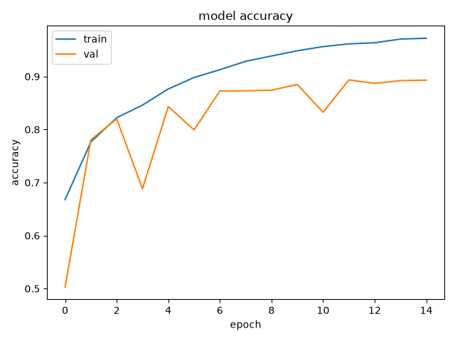
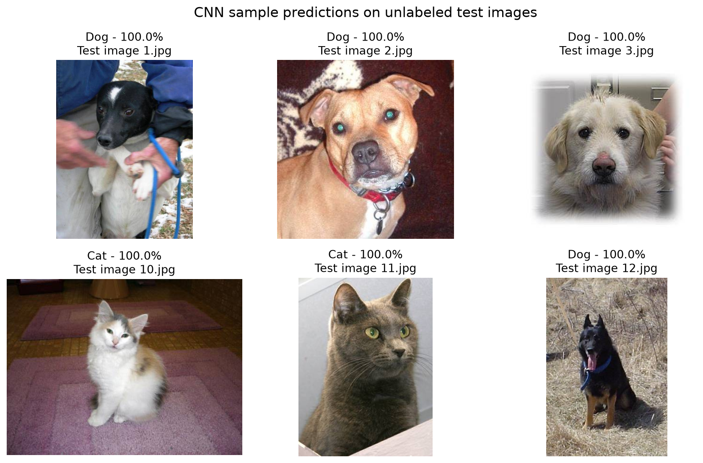

# Cat and Dog Image Classification Using CNN

**Project author: Mr Manish Kumar**

This project trains a custom convolutional neural network (CNN) to classify cat and dog images. The live webcam application also uses this same trained CNN.

> **Dataset note:** This version uses the Dogs vs. Cats image dataset already downloaded for the project. It is a public dataset, not a dataset personally photographed by the author. If an instructor specifically requires self-collected images, replace or supplement it with your own labeled images and report their source accurately.

## What the project does

- Loads labeled cat/dog images and resizes them to 110 × 110 pixels.
- Trains a CNN on 18,000 images with an 80/20 training/validation split.
- Saves the trained model, training history, accuracy/loss plots, and test-image prediction video in `output/`.
- Loads the saved CNN model for live webcam classification and displays `Cat` or `Dog` with its model confidence.

## Completed training results

| Metric | Result |
|---|---:|
| Images used | 18,000 |
| Training / validation split | 14,400 / 3,600 (80% / 20%) |
| Epochs | 15 |
| Final training accuracy | 97.21% |
| Final validation accuracy | 89.31% |
| Final validation loss | 0.3293 |

Validation accuracy is measured on the held-out validation split. The unlabeled `dataset/test1` images are used for prediction examples, not for calculating accuracy. A confidence score is not a guarantee of correctness.

### Accuracy



### Loss


### CNN sample predictions

These are example labels from the unlabeled `dataset/test1` folder. They demonstrate the model output; they are not an accuracy evaluation.



## Project structure

```text
image-classification-using-cnn/
├── dataset/                         # Download and extract separately (not committed)
│   ├── train/                       # Labeled cat/dog images
│   └── test1/                       # Unlabeled test images (optional)
├── output/
│   ├── 18_000.h5                    # Trained CNN used by webcam
│   ├── 18_000_history.pickle        # Per-epoch training metrics
│   ├── 18_000_15epoch_accuracy.png  # Accuracy graph
│   ├── 18_000_15epoch_loss.png      # Loss graph
│   ├── cnn_sample_predictions.png   # Sample CNN predictions
│   └── prediction.mp4               # Example predictions from test1
├── constants.py                     # Dataset and model settings
├── data_prep.py                     # Image loading and preprocessing
├── model.py                         # CNN architecture
├── main.py                          # CNN training and output generation
├── live_camera.py                   # Live webcam CNN classification
└── requirements.txt
```

## Run the trained CNN on a webcam

Training is already complete and `output/18_000.h5` is included. To run the live classifier, **do not run `main.py`**; that command starts training again.

### 1. Install Python

Install Python 3.12 (64-bit). In Windows PowerShell, check it with:

```powershell
py -3.12 --version
```

### 2. Download or clone the project

```powershell
git clone https://github.com/manish7417/cat-dog-image-classification.git
cd cat-dog-image-classification
```

Or use **Code → Download ZIP** on GitHub and open the extracted folder.

### 3. Install dependencies

Run in PowerShell from the project folder:

```powershell
py -3.12 -m venv .venv
.\.venv\Scripts\Activate.ps1
python -m pip install --upgrade pip
pip install -r requirements.txt
```

If PowerShell prevents environment activation, install using the environment's Python directly:

```powershell
.\.venv\Scripts\python.exe -m pip install -r requirements.txt
```

### 4. Start live camera classification

```powershell
py -3.12 live_camera.py
```

Show a cat or dog to the camera. The CNN classifies the **whole camera frame** and overlays the predicted label and confidence. Press **Q** in the camera window to close it. Close other apps that may be using the webcam before starting.

### Important limitation

This is a two-class CNN trained only on cats and dogs. It always predicts one of those two classes; it has no `Person` or `Other` class and cannot draw animal bounding boxes. A human or unrelated scene may therefore be mislabeled as Cat or Dog. Confidence is only the model's score, not proof the label is correct. To reliably reject other objects, add appropriately labeled non-cat/dog examples (or extra classes) and retrain.

## Optional: train the CNN again

### 1. Download the dataset

Use the [Dogs vs. Cats dataset archive](https://drive.google.com/file/d/19inwa0n1W4DZamjCOm5XAlztvqG_xkjP/view?usp=sharing). Extract `train.zip` and, optionally, `test1.zip` into the project so the paths look like:

```text
dataset/
├── train/
│   ├── cat.0.jpg
│   ├── dog.0.jpg
│   └── ...
└── test1/
    ├── 1.jpg
    ├── 2.jpg
    └── ...
```

### 2. Start training

Activate the virtual environment and run:

```powershell
python main.py
```

The script uses up to 18,000 shuffled images from `dataset/train`, a batch size of 50, and 15 epochs. A full retraining run overwrites the trained model and result files in `output/`.

### 3. Training outputs

| File | Description |
|---|---|
| `output/18_000.h5` | Trained CNN; used by `live_camera.py` |
| `output/18_000_history.pickle` | Training and validation metrics |
| `output/18_000_15epoch_accuracy.png` | Accuracy graph |
| `output/18_000_15epoch_loss.png` | Loss graph |
| `output/prediction.mp4` | Predictions for up to 200 images in `dataset/test1` |
| `logs/` | TensorBoard logs |

## CNN architecture

- Input: 110 × 110 × 3 RGB image
- Five convolution layers with 3 × 3 filters: 32, 64, 96, 96, and 64 filters
- ReLU activation, max pooling, batch normalization, and dropout
- Dense layers: 256 and 128 units; two-unit softmax output
- Optimizer: Adam; loss: binary cross-entropy
- Labels: Cat = 0, Dog = 1

## Troubleshooting

| Problem | Solution |
|---|---|
| `py -3.12` is not recognized | Install Python 3.12 (64-bit), then reopen the terminal. |
| `ModuleNotFoundError` | Activate `.venv` and run `pip install -r requirements.txt`. |
| Camera will not open | Close Camera, Teams, Zoom, or any app using it; reconnect the webcam and try again. |
| Model file not found | Confirm `output/18_000.h5` is present in the project folder. |
| `main.py` cannot find data | Check that `dataset/train` exists and contains files named like `cat.0.jpg` and `dog.0.jpg`. |
| Prediction is incorrect | Try a clear, close-up cat/dog image with good lighting. Binary classification can mislabel other scenes. |

## Credits

- **Project author:** Mr Manish Kumar
- The current dataset archive is linked above; its source and license should be retained when redistributing the dataset.

## Project report

[Download the CNN-only capstone report](./Cat_Dog_CNN_Project_Report.docx)
